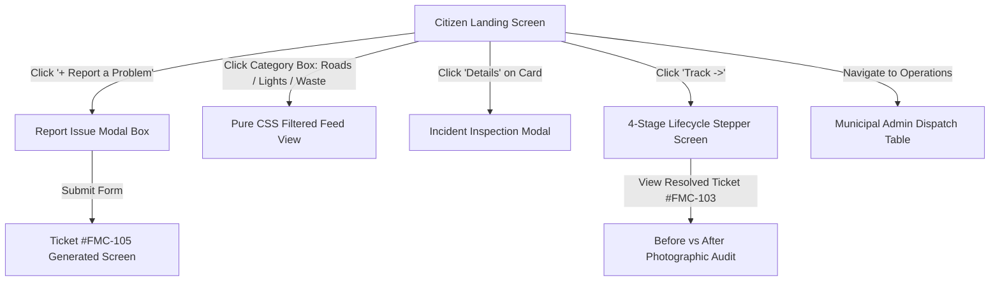

# 🎨 Fix My City — Figma UI/UX Prototype Specification & Design Architecture

---

## 1. Minimalist Monochrome Design System (Option 4)

### 1.1 Color Tokens
| Token Name | Hex Code | Usage | Figma Variable Name |
| :--- | :--- | :--- | :--- |
| **Monochrome Primary** | `#000000` | Main buttons, brand headers, active filter boxes | `color/primary/black` |
| **Monochrome Hover** | `#262626` | Button hover state, interactive highlights | `color/primary/hover` |
| **Canvas Background** | `#FAFAFA` | Neutral page background | `color/surface/background` |
| **Card Surface** | `#FFFFFF` | Clean white card surfaces | `color/surface/card` |
| **Hairline Border** | `#E5E5E5` | Sharp 1px borders, dividing rules, inputs | `color/border/subtle` |
| **Text Primary** | `#000000` | Display headers, titles, primary text | `color/text/primary` |
| **Text Secondary** | `#525252` | Body descriptions, subheaders | `color/text/secondary` |
| **Text Muted** | `#737373` | Timestamps, SLA captions, metadata | `color/text/muted` |
| **Status: Open** | `#DC2626` / `#FEF2F2` | Open / Triage indicator dot & soft badge | `color/status/open` |
| **Status: In Progress**| `#D97706` / `#FFFBEB` | Crew active indicator dot & soft badge | `color/status/in-progress` |
| **Status: Resolved** | `#16A34A` / `#F0FDF4` | Verified fixed indicator dot & soft badge | `color/status/resolved` |

### 1.2 Corner Radius & Elevation (Sharp Boxes, No Pills)
* **Buttons & Action Boxes**: `border-radius: 6px` (sharp modern box, zero oval pills).
* **Badges & Tags**: `border-radius: 4px` (compact rectangular status boxes).
* **Cards & Containers**: `border-radius: 8px` (clean rectangular container).
* **Elevation**: Subtle 1px shadow `0 1px 2px rgba(0, 0, 0, 0.05)`, no muddy or colored drop shadows.

### 1.3 Typography Hierarchy (Inter / SF Pro Display)
* **Display H1**: `32px / 40px`, Bold (700), Letter-spacing `-0.02em` — Hero headline.
* **Section H2**: `22px / 28px`, Bold (700), Letter-spacing `-0.015em` — Section titles.
* **Card Title H3**: `16px / 22px`, SemiBold (600) — Complaint card headers.
* **Body Regular**: `13px / 18px`, Regular (400) — Descriptions, addresses.
* **Code / IDs**: `12px / 16px`, JetBrains Mono Medium (500) — `#FMC-101`, `#FMC-102`.

---

## 2. Screen-by-Screen UI/UX Architecture

### Frame 1: Citizen Landing & Real Feed
* **Header / Navigation Bar**:
  * Logo: "FixMyCity" in bold black with compact 6px square geo-badge.
  * Sub-badge: "RBU Campus, Nagpur".
  * Primary Action: `+ Report a Problem` box button.
* **Hero Banner**:
  * Title: *"Spotted a problem in your city? Report it. Track it. Get it fixed."*
  * Quick metric boxes: `4 Total Reports`, `1 Resolved (25%)`, `2 In Progress`, `1 Open / Triage`.
* **Category Filter Toolbar (Box Buttons)**:
  * Rectangular box buttons: `All (4)`, `Roads & Potholes (1)`, `Street Lighting (1)`, `Waste (1)`, `Water & Drainage (1)`.
* **Feed Grid**: Exactly 4 authentic verified complaints at Ramdeobaba University, Katol Road, Nagpur.

### Frame 2: "Report an Issue" Submission Modal
* **Category Selector**: 4-box grid (Roads, Lighting, Waste, Water).
* **Inputs**: Title, incident address (Nagpur campus pre-filled), description textarea.
* **Submission Action**: Solid jet-black button routing to Confirmation Screen (`#FMC-105` generated).

### Frame 3: Geospatial Incident Grid
* OpenStreetMap satellite view centered on **Shri Ramdeobaba University, Katol Road, Nagpur (21.1764° N, 79.0617° E)**.
* Floating GPS coordinate overlay mapping all 4 active incidents.

### Frame 4: Ticket Lifecycle Tracker & Verification Audit
* 4-Stage Visual Progress Stepper: `1. Registered` -> `2. Verified` -> `3. Crew Dispatched` -> `4. Resolved`.
* Side-by-side photographic verification audit for `#FMC-103` (`garbage.jpg` vs `street_cleaned.jpg`).

### Frame 5: Municipal Operations Command Center
* Administrative table with columns: `Ticket #`, `Category`, `Incident Title & Location`, `Department`, `Status`, `Action`.

---

## 3. Figma Prototyping Interaction Flow

