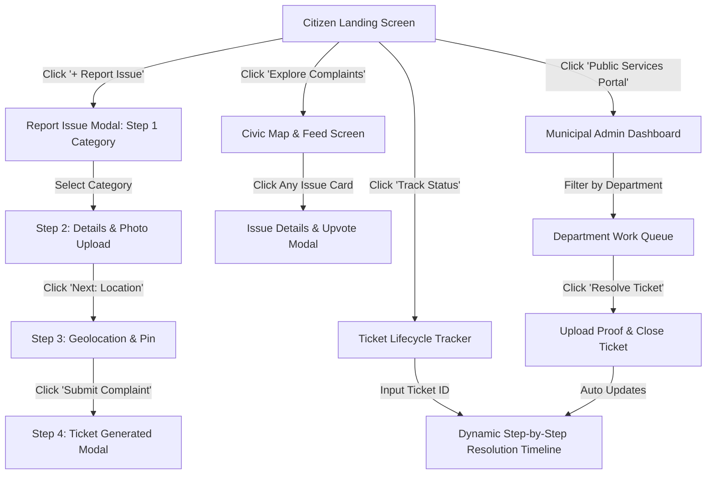

# 🎨 Fix My City — Figma UI/UX Prototype Specification & Design Architecture

---

## 1. Design System & Style Tokens

### 1.1 Color Palette
| Token Name | Hex Code | Usage | Figma Variable Name |
| :--- | :--- | :--- | :--- |
| **Civic Primary (Emerald)** | `#0D9488` / `#0F766E` | Main branding, primary CTAs, active navigation | `color/primary/default` |
| **Civic Navy (Slate Dark)** | `#0F172A` | Primary text, navbar headers, dark surfaces | `color/surface/navy-dark` |
| **Accent Orange** | `#F97316` | Urgent tags, pending alerts, callouts | `color/accent/warning` |
| **Status: Open / Reported** | `#E11D48` | Critical badge, newly registered complaint | `color/status/open` |
| **Status: In Progress** | `#D97706` | Municipal crew assigned / work underway | `color/status/in-progress` |
| **Status: Resolved** | `#16A34A` | Successfully fixed and verified | `color/status/resolved` |
| **Neutral Light** | `#F8FAFC` | Main app background canvas | `color/surface/background` |
| **Border & Divider** | `#E2E8F0` | Card borders, dividers, form outlines | `color/border/subtle` |

### 1.2 Typography Hierarchy (Inter / System Sans)
* **Display H1**: `32px / 40px Line-height`, Bold (700) — Hero header
* **Section H2**: `24px / 32px Line-height`, SemiBold (600) — Section headings, modal titles
* **Card Title H3**: `18px / 26px Line-height`, SemiBold (600) — Issue cards, metric headers
* **Body Regular**: `14px / 20px Line-height`, Regular (400) — Descriptions, instructions
* **Metadata / Caption**: `12px / 16px Line-height`, Medium (500) — Timestamps, badges, IDs

### 1.3 Grid & Elevation
* **Desktop Canvas**: `1440px` width, 12-column grid, `80px` margin, `24px` gutter.
* **Mobile Canvas**: `390px` width (iPhone 14/15/16 standard), 4-column grid, `16px` margin, `16px` gutter.
* **Elevation 1 (Cards)**: `0 2px 4px rgba(15, 23, 42, 0.06)`
* **Elevation 2 (Modals / Overlays)**: `0 12px 24px rgba(15, 23, 42, 0.12)`

---

## 2. Screen-by-Screen UI/UX Architecture

### Frame 1: Citizen Landing & Hero (Desktop & Mobile)
* **Header / Navigation Bar**:
  * Logo: "Fix My City" with green geo-pin icon.
  * Nav links: *Report Issue*, *Explore Feed*, *Track Status*, *Departments*, *Admin Portal*.
  * Primary Button CTA: `+ Report an Issue`.
* **Hero Banner**:
  * Punchy title: *"Spotted an issue in your neighborhood? Let's get it fixed."*
  * Quick metric counters: `14,890+ Issues Resolved`, `94% Municipal Response Rate`, `48h Avg. Resolution`.
  * Search & Category quick-pills (Potholes, Streetlights, Garbage, Water Leak, Traffic).

### Frame 2: "Report an Issue" 4-Step Interactive Modal / Flow
* **Step 1: Category Selection**:
  * Grid of 6 interactive icon cards (Roads & Potholes, Waste & Sanitation, Street Lights & Power, Water Supply & Drainage, Parks & Trees, Traffic & Signage).
* **Step 2: Issue Details & Evidence**:
  * Input fields: Title, description, severity selector (`Low`, `Medium`, `High`, `Emergency`).
  * Image upload box with drag-and-drop & live photo thumbnail preview.
* **Step 3: Geolocation & Pin**:
  * GPS "Use Current Location" auto-fill button.
  * Address text input + interactive map pin placement with landmark note.
* **Step 4: Submission Confirmation**:
  * Success illustration, assigned Ticket Tracking Code (e.g. `#FMC-8942`), Estimated Response SLA, and "Share with Neighbors" button.

### Frame 3: Civic Issues Feed & Interactive Geospatial Map
* **Toggle Bar**: Switch between **Map View** (Leaflet/Mapbox clusters) and **List / Card View**.
* **Filter Bar**: Filter by Status (`All`, `Reported`, `Under Investigation`, `In Progress`, `Resolved`), Category, and Ward/Zone.
* **Issue Card Component**:
  * Category badge + Status badge (color-coded).
  * Photo thumbnail + title + address + reported time (e.g., *"2 hours ago"*).
  * Community Upvote / "Me Too" count (shows public urgency).
  * "Track Progress" quick link.

### Frame 4: Complaint Tracker & Live Lifecycle Timeline
* **Search / Lookup Bar**: Enter Ticket ID (e.g. `#FMC-1042`).
* **Visual Stepper Timeline (Vertical / Horizontal)**:
  1. `Reported`: Timestamp, citizen evidence.
  2. `Reviewed & Verified`: Municipal desk validation, priority assigned.
  3. `Crew Dispatched`: Assigned department (e.g., *Public Works Division 4*), crew lead name.
  4. `Resolved & Closed`: Resolution proof photo (Before & After), completion timestamp, citizen feedback rating.

### Frame 5: Public Services & Municipal Officer Dashboard (Admin)
* **Top Metric Ribbon**: Total Active Tickets, SLA Breaches, Resolved Today, Citizen Satisfaction Index.
* **Triage & Operations Board**:
  * Quick status updater dropdown (`Under Review` -> `Assigned` -> `In Progress` -> `Resolved`).
  * Filter tickets by municipal department (*Department of Transportation*, *Solid Waste Management*, *Water Works*, *Electricity Board*).
  * Resolution Action Modal: Upload "Fixed" verification image, enter resolution remarks, mark complete.

---

## 3. Figma Prototyping Connections & Interaction Flow

### Prototyping Settings in Figma:
* **Modal opens**: Trigger `On Click` -> Action `Open Overlay` -> Position `Center` -> Animation `Fade in` (200ms `Ease-out`).
* **Category selection**: Trigger `On Click` -> Action `Set Variable / Change To` (Active stroke highlight `#0D9488`).
* **Before / After Image Slider**: Trigger `On Drag` -> Action `Smart Animate` between Before and After frames.
* **Tab Switcher (Map vs List)**: Trigger `On Click` -> Action `Navigate To` (Instant or `Dissolve` 150ms).
